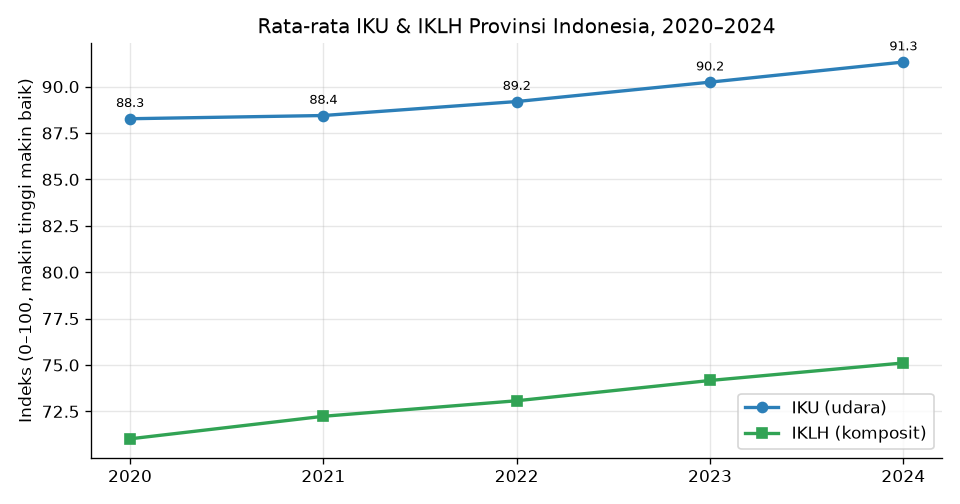
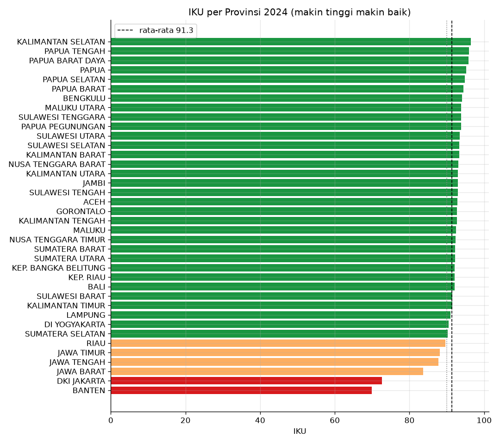
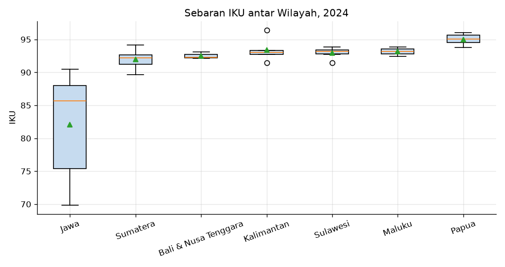
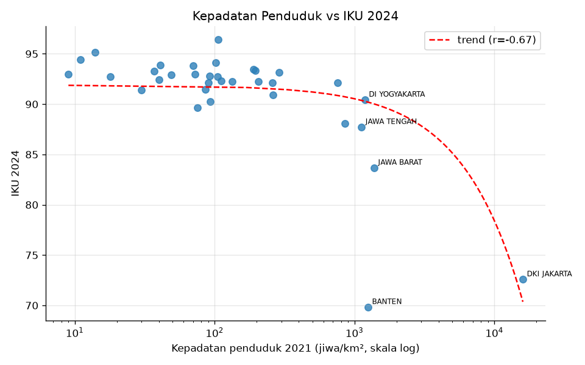
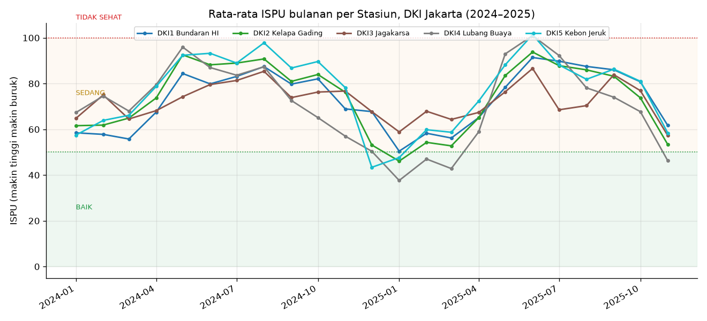
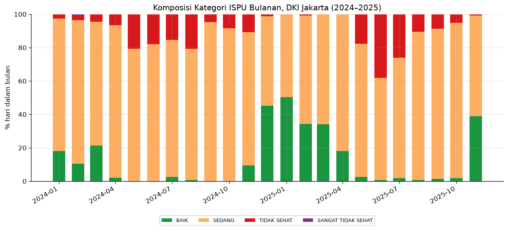
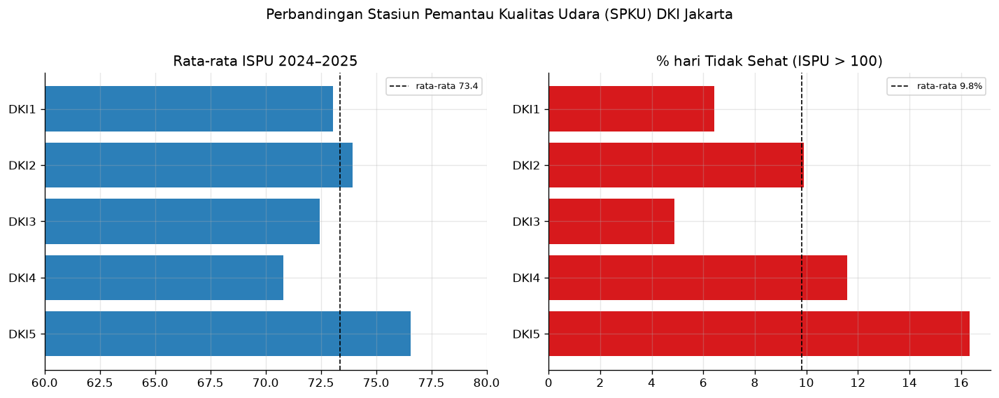
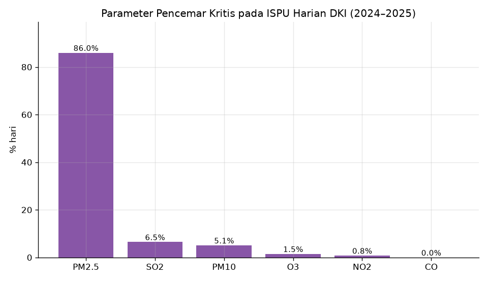
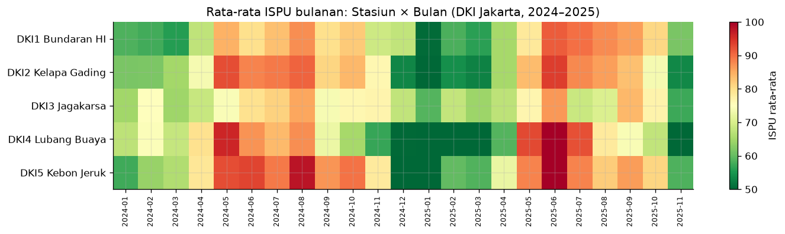
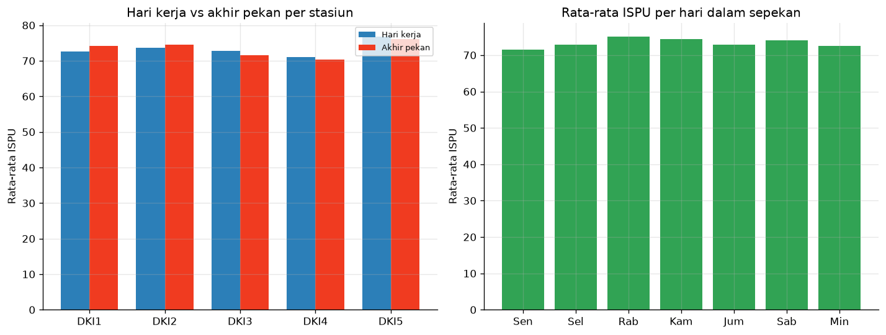

# Analisis Kualitas Udara Indonesia
### Kualitas Udara Provinsi (IKU/IKLH 2020–2024) & Studi Kasus Harian DKI Jakarta (ISPU 2024–2025)

Proyek portofolio **Data Analyst**: mengolah data resmi pemerintah untuk menjawab dua pertanyaan —
bagaimana kualitas udara **antar-provinsi di Indonesia** selama lima tahun, dan bagaimana kondisi
**harian di DKI Jakarta** selama dua tahun. Seluruh angka diturunkan dari data (tidak ada yang dikarang)
dan setiap sumber dicatat di [`DATA_SOURCES.md`](DATA_SOURCES.md).

## Temuan Utama
- **Nasional membaik, tapi tidak merata.** Rata-rata IKU provinsi naik **+3,06 poin** (88,27 → 91,33, 2020–2024); IKLH komposit +4,09 poin.
- **Kesenjangan wilayah.** Jawa terendah (rata-rata 82,06) vs Papua tertinggi (95,00). Terbaik KALIMANTAN SELATAN (96,41); terburuk BANTEN (69,84) — selisih 26,57 poin.
- **Kepadatan penduduk berhubungan negatif dengan IKU** (Pearson **r = −0,67**, p < 0,001, n = 34). Korelasi, **bukan** kausalitas.
- **Jakarta (ISPU harian 2024–2025).** Dari **3.480** pengamatan valid, rata-rata ISPU **73,4** (kategori *Sedang*): 77% hari *Sedang*, 12,8% *Baik*, 9,8% *Tidak Sehat*, 1 hari *Sangat Tidak Sehat*.
- **PM2.5 pencemar kritis pada 86% hari** — masalah utama Jakarta adalah partikulat halus, bukan NO₂/SO₂ yang menjadi basis IKU.
- **Barat terburuk, Timur terbaik.** Jakarta Barat (76,6; 16,3% hari tidak sehat) vs Jakarta Timur (70,8).
- **Pola musiman kuat.** ISPU memuncak saat kemarau (Juni 2025 = 94,8) dan terendah saat hujan (Januari 2025 = 48,1). Hari kerja (73,36) ≈ akhir pekan (73,37).

> ⚠️ **IKU ≠ ISPU.** IKU (skala 0–100, **makin tinggi makin baik**, dari NO₂ & SO₂, **tahunan**) berbeda dari ISPU (skala 0–500+, **makin tinggi makin buruk**, **harian**). Keduanya tidak dicampur.

## Visualisasi
**Nasional — IKU/IKLH 2020–2024**

| Tren nasional | Peringkat provinsi 2024 |
|---|---|
|  |  |

| IKU per wilayah | Korelasi kepadatan vs IKU |
|---|---|
|  |  |

**DKI Jakarta — ISPU harian 2024–2025**

| Tren ISPU bulanan | Komposisi kategori bulanan |
|---|---|
|  |  |

| Perbandingan stasiun | Pencemar kritis |
|---|---|
|  |  |

| Heatmap bulanan | Pola harian (hari kerja vs akhir pekan) |
|---|---|
|  |  |

## Struktur Proyek
```
analisis-kualitas-udara-indonesia/
├── notebooks/
│   ├── 01_data_collection.ipynb     # unduh & ekstrak data mentah dari sumber resmi
│   ├── 02_data_cleaning.ipynb       # audit, normalisasi, wide→long, master
│   ├── 03_eda_nasional.ipynb        # EDA IKU/IKLH 38 provinsi → 6 gambar
│   ├── 04_studi_kasus_jakarta.ipynb # ISPU harian DKI (fetch API → clean → EDA) → 6 gambar
│   └── 05_insight_rekomendasi.ipynb # hitung ulang angka + susun laporan
├── data/
│   ├── raw/        # data mentah (dapat dilacak ke DATA_SOURCES.md)
│   └── processed/  # data analysis-ready (CSV)
├── images/         # 12 visualisasi (6 nasional + 6 Jakarta)
├── reports/
│   └── RINGKASAN_LENGKAP.md   # ringkasan eksekutif, insight, rekomendasi, LinkedIn, CV
├── DATA_SOURCES.md # dokumentasi sumber, lisensi, skema kolom, keterbatasan
└── requirements.txt
```

## Sumber Data
Semua sumber resmi pemerintah:
1. **KLHK** — *Statistik Lingkungan Hidup Vol. I 2025* (PDF) → IKU provinsi & kab/kota, IKLH provinsi 2020–2024.
2. **BPS** — komponen penyusun IKLH 2024 & kepadatan penduduk provinsi (verifikasi silang).
3. **Satu Data Jakarta** — *Data ISPU di Provinsi DKI Jakarta* (Dinas Lingkungan Hidup DKI), ditarik otomatis via API `POST /backend/api/v2/satudata/detail`.

Detail lengkap (URL, tanggal unduh, skema kolom) ada di [`DATA_SOURCES.md`](DATA_SOURCES.md).

## Cara Menjalankan
```bash
python -m pip install -r requirements.txt
python -m jupyter notebook   # lalu jalankan notebook 01 → 05 secara berurutan
```
Notebook 01 & 04 menarik data langsung dari sumber resmi (butuh internet). Jika `data/raw/` sudah terisi,
notebook akan memakai berkas lokal agar tidak mengunduh ulang.

## Tech Stack
Python 3.14 · pandas · NumPy · matplotlib · seaborn · SciPy · statsmodels · requests · pdfplumber/pypdf · openpyxl · Jupyter

## Keterbatasan
- IKU/IKLH resmi **hanya sampai 2024**; IKU tahunan 2025 belum terbit.
- ISPU Jakarta **berakhir 30 November 2025** (belum ada data 2026) dan hanya mencakup **5 stasiun** (DKI1–DKI5).
- 13 baris ISPU bernilai 0 tanpa polutan = placeholder "tidak ada data" (dikosongkan saat cleaning).
- Kepadatan penduduk hanya tersedia untuk 2021 (34 provinsi lama).
- **Kendaraan bermotor tidak dianalisis** (data tidak dapat diotomatisasi dari sumber publik).
- Analisis korelasi **tidak** membuktikan sebab-akibat.

## Atribusi & Lisensi
Data milik **KLHK, BPS, dan Pemerintah Provinsi DKI Jakarta**. Kategori ISPU mengikuti **Permen LHK No. 14/2020**.
Kode dan analisis dalam repo ini bebas digunakan dengan atribusi ke sumber data asli.

---
Dibuat oleh [@imanuelrpt](https://github.com/imanuelrpt) sebagai portofolio Data Analyst.
